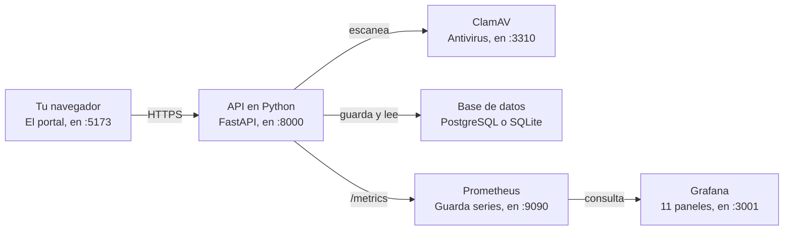

# Levantar el portal en tu computadora

Ventanilla Única Municipal · Caso 3: Permisos Municipales

## Qué vas a levantar



Tú sólo abres **el portal** en el navegador. Todo lo demás trabaja detrás: el portal le habla a la API, y es la API — nunca el navegador — la que escanea los documentos con ClamAV y escribe en la base de datos.

Las tres piezas de abajo son opcionales para que el portal funcione: sirven para **ver** cómo se comporta el sistema. La API publica sus números en `/metrics`, Prometheus los recoge cada 15 segundos y Grafana los dibuja.

No hace falta entender todo esto para usar la guía. Basta con saber que, si algo no responde, lo primero es preguntarse **cuál de las seis piezas se quedó abajo**.

## Antes de empezar

Hay dos caminos. **Elige uno solo.**

| | Camino A · Docker | Camino B · sin Docker |
| --- | --- | --- |
| Para qué sirve | Ver el sistema completo, con Grafana y el antivirus real | Ver el código trabajando, arranca más rápido |
| Qué necesitas | Docker Desktop y Git | Python 3.12 o 3.13, y Git |
| Base de datos | PostgreSQL | SQLite (un archivo) |
| Cuentas de prueba | Hay que crearlas | Se crean solas |
| Tiempo la primera vez | 5–10 minutos | 2–3 minutos |

**Para la presentación en clase, usa el Camino A.** Es el único que enseña Grafana y ClamAV de verdad.

### Comprueba que lo tienes

Abre una terminal y escribe:

```
git --version
docker --version        # sólo para el Camino A
python --version        # sólo para el Camino B
```

Si alguno responde «command not found» o «no se reconoce», falta instalarlo.

- **Git** — [git-scm.com/downloads](https://git-scm.com/downloads)
- **Docker Desktop** — [docker.com/products/docker-desktop](https://www.docker.com/products/docker-desktop/)
- **Python** — [python.org/downloads](https://www.python.org/downloads/). Baja la 3.13, **no la 3.14**: las versiones de las librerías que fija el proyecto todavía no tienen paquetes para ella.

En Windows, usa **Git Bash** (viene con Git) en vez del símbolo del sistema. Los comandos de esta guía están escritos para esa terminal.

## Camino A · Con Docker

Un solo comando levanta los seis servicios. **Abre Docker Desktop antes de empezar** y espera a que diga «Running».

### 1. Baja el proyecto

```
git clone https://github.com/Mirandosky-12/Ing-de-Software.git
cd Ing-de-Software
git checkout prueba-local
```

El `git checkout` es importante: **la rama `main` no tiene la base de datos ni la API completa.** Todo lo que describe esta guía vive en `prueba-local`.

### 2. Levántalo

```
./levantar.sh
```

Eso crea las claves de cifrado si faltan, construye las imágenes y arranca todo. La primera vez tarda varios minutos porque baja las imágenes de PostgreSQL, ClamAV, Prometheus y Grafana.

**ClamAV tarda ~2 minutos más** en descargar su base de firmas. Mientras tanto, el portal rechaza los documentos con un error 503. Para saber cuándo terminó:

```
docker compose logs -f clamav
```

Espera a ver `Self checking every 600 seconds` y cierra con `Ctrl+C`.

### 3. Abre el portal

| Qué | Dónde | Entrar con |
| --- | --- | --- |
| **Portal** | http://localhost:5173 | las cuentas de la sección siguiente |
| Documentación de la API | http://localhost:8000/docs | — |
| Salud del sistema | http://localhost:8000/salud | — |
| Grafana | http://localhost:3001 | admin / admin |
| Prometheus | http://localhost:9090 | — |

### Si un puerto está ocupado

Si ya usas el 3001 o el 5173 para otra cosa, cámbialo al levantar:

```
PUERTO_GRAFANA=3002 PUERTO_PORTAL=5180 ./levantar.sh
```

Las variables disponibles son `PUERTO_PORTAL`, `PUERTO_API`, `PUERTO_GRAFANA`, `PUERTO_PROMETHEUS` y `PUERTO_CLAMAV`.

## Camino B · Sin Docker

Más rápido de arrancar. Usa SQLite, así que la base de datos es un solo archivo, y **las dos cuentas de prueba se crean solas**. No tendrás ClamAV ni Grafana.

Necesitas **dos terminales abiertas al mismo tiempo**: una para la API, otra para el portal.

### Terminal 1 · la API

```
cd Ing-de-Software/portal-permisos/backend

python -m venv .venv
source .venv/bin/activate          # Windows: .venv\Scripts\activate
pip install -r requirements-dev.txt

export CLAVE_CIFRADO=$(python -c "from cryptography.fernet import Fernet; print(Fernet.generate_key().decode())")
uvicorn main:app --reload --port 8000
```

Déjala abierta. Cuando veas `Application startup complete`, la API está lista.

> **Guárdate esa clave.** `CLAVE_CIFRADO` es la que cifra las cédulas. Si la pierdes o generas otra, las cédulas ya guardadas no se pueden leer. Para no generarla cada vez, guárdala en un archivo y reusa la misma.

### Terminal 2 · el portal

```
cd Ing-de-Software/portal-permisos
python -m http.server 5173
```

### Abre el navegador

Entra a **http://localhost:5173**.

> **No abras `index.html` con doble clic.** Parece que funciona, pero el navegador bloquea las peticiones de un archivo local hacia la API, y el portal se queda en *modo demostración*: las cuentas que crees ahí se borran al recargar. Tiene que ser por `http://localhost:5173`.

También importa **escribir `localhost` y no `127.0.0.1`**: para el navegador son dos orígenes distintos, y la API sólo autoriza `localhost:5173` y `localhost:3000`. Si necesitas otro, levántala con `CORS_ORIGENES=http://mi-origen` delante del comando de `uvicorn`.

### Cómo saber que sí está conectado

Debajo del formulario de inicio de sesión, el portal dice **«Conectado a la base de datos»**. Si dice *«Modo demostración»*, algo de lo anterior falla — ve a la sección **Si algo falla**.

## Las dos cuentas

El portal tiene **una sola página de entrada con dos puertas**. Arriba del formulario eliges *Soy solicitante* o *Soy funcionario*; cada una muestra su cuenta de prueba.

| Puerta | Correo | Contraseña | Qué ve |
| --- | --- | --- | --- |
| Soy solicitante | `demo@mupa.gob.pa` | `demo1234` | Sus expedientes, el asistente, citas |
| Soy funcionario | `revisor@mupa.gob.pa` | `revisor1234` | La bandeja con las solicitudes de todos |

La puerta no es decoración: si entras con una cuenta de ciudadano por la puerta de funcionario, el portal lo rechaza. Y aunque alguien se saltara la interfaz, **la API devuelve 403**: quien decide es el servidor, no la pantalla.

### En el Camino B, ya existen

Con SQLite las dos cuentas se siembran solas al arrancar la API. No tienes que hacer nada.

### En el Camino A, hay que crear el funcionario

Con Docker la base es PostgreSQL y **no se crea ninguna cuenta**, a propósito: en un sistema real nadie se registra como revisor desde el portal.

1. Entra al portal y **crea tu cuenta normal** en «Crear cuenta». Nace como ciudadano.
2. Asciéndela a revisora desde la terminal:

```
docker compose run --rm migraciones python migrar.py --rol revisor tu-correo@ejemplo.com
```

3. Vuelve al portal, entra por la puerta **Soy funcionario** con ese mismo correo, y verás la bandeja.

Los roles posibles son `ciudadano`, `revisor` y `director`. Para la demostración conviene tener **dos cuentas**: una ciudadana que solicita y una revisora que resuelve.

## Recorrido de demostración

Este es el guion para enseñar el sistema completo en unos 10 minutos. Antes de empezar, ten listo **un archivo PDF cualquiera** en el escritorio.

### Como solicitante

1. Entra por la puerta **Soy solicitante**.
2. Pulsa **Solicitar permiso** y busca un trámite — escribe `ferrete` en el buscador. Se ven los requisitos y el plazo legal.
3. Llena los datos del acto. **La fecha debe ser al menos 15 días después de hoy**; si pones una más cercana, el portal la rechaza. Esa regla la aplican el portal y la API por separado.
4. Adjunta el PDF. Mira cómo pasa por las cinco verificaciones: formato, tamaño, antivirus, huella SHA-256 y sellado.
5. Revisa el resumen, marca la declaración jurada y envía. Anota el número de expediente.

> **El truco que vale la pena enseñar:** renombra el PDF a `eicar.pdf` y súbelo. ClamAV lo bloquea y el documento nunca llega al expediente. En el Camino A el bloqueo es real; en el B está simulado.

### Como funcionario

6. **Cerrar sesión**. Entra por la puerta **Soy funcionario**.
7. La solicitud recién creada está en la bandeja, con el correo de quien la pidió. Pulsa **Revisar**.
8. Se ve el expediente completo, la huella del documento y el historial. Pulsa **Pasar a revisión**.
9. Ábrelo otra vez y pulsa **Subsanación** sin escribir nada: **no te deja**. Un rechazo sin explicación no es una resolución.
10. Escribe el motivo — por ejemplo *«Falta la póliza de responsabilidad civil»* — y resuelve.

### De vuelta como solicitante

11. Cierra sesión y entra otra vez por la puerta del solicitante.
12. El expediente está en **Subsanación**, y el motivo que escribió la revisora aparece como la etapa actual. **La decisión viajó de una cuenta a la otra a través de la base de datos.**

### El cierre

13. Abre http://localhost:8000/api/bitacora/verificar en el navegador. Responde `{"integra": true}`: la cadena de auditoría está intacta.
14. Si estás en el Camino A, abre Grafana y enseña los paneles moviéndose con lo que acabas de hacer.

## Ver la base de datos

El proyecto trae `ver_bd.py`, en `portal-permisos/backend/`. Sólo lee, nunca escribe, y **funciona igual con SQLite y con PostgreSQL**.

```
cd portal-permisos/backend

python ver_bd.py                    # cuántas filas hay en cada tabla
python ver_bd.py cuentas            # el contenido de una tabla
python ver_bd.py expedientes -n 5   # sólo las primeras 5
python ver_bd.py --bitacora         # la cadena de auditoría
python ver_bd.py --expediente EXP-2026-004183
```

Con Docker, el mismo comando dentro del contenedor:

```
docker compose exec api python ver_bd.py
```

Si prefieres hacer clic, en el Camino B puedes abrir el archivo `backend/mupa.db` con **DB Browser for SQLite**, que es gratis. Con Docker no se puede: PostgreSQL está a propósito sin puerto publicado hacia tu máquina.

### Las dos cosas que vale la pena enseñar

**1. La bitácora está encadenada.** Corre `python ver_bd.py --bitacora` y mira la columna `previo` de cada fila: es el `hash` de la fila anterior.

```
n   accion             actor                hash          previo
24  sesion.cerrada     diego@utp.ac.pa      8bc0d472888f  afc1157168b9
25  sesion.iniciada    diego@utp.ac.pa      6aa3e9c5d55a  8bc0d472888f
26  sesion.iniciada    revisor@mupa.gob.pa  b25c9e069b13  6aa3e9c5d55a

   Integridad de la cadena: íntegra ✓
```

**2. No se deja alterar.** Intenta modificar una fila conectándote directo al archivo, por fuera de la aplicación:

```
update bitacora set actor='otro@ejemplo.com' where n=1;
→ rechazado por la base: bitacora es de solo anexado
```

No lo impide el programa: lo impiden los *triggers* que crea `migrar.py`. Aunque alguien tenga el archivo de la base en la mano, la auditoría no se reescribe. Eso es lo que sostiene la validez legal del expediente bajo la Ley 51 de 2008.

> En la tabla `cuentas` verás la cédula como texto ilegible y la contraseña como `pbkdf2_sha256$…`. Está bien: la cédula va cifrada por la Ley 81 y la clave es un hash. `ver_bd.py` ni siquiera las imprime.

## Si algo falla

| Lo que ves | Por qué pasa | Qué hacer |
| --- | --- | --- |
| El portal dice **«Modo demostración»** y las cuentas se borran al recargar | No alcanza la API | Lo más probable: abriste `index.html` con doble clic. Sírvelo por HTTP y entra por `http://localhost:5173` |
| Sigue en modo demostración aunque lo sirvas por HTTP | La API no responde, o el origen no está autorizado | Comprueba `http://localhost:8000/salud` en el navegador. Usa `localhost`, no `127.0.0.1`. Abre F12 → Consola: un error de CORS se ve clarísimo |
| **«Docker no responde»** al correr `./levantar.sh` | Docker Desktop no está abierto | Ábrelo, espera a que diga *Running*, reintenta |
| **«port is already allocated»** | Otro programa usa ese puerto | `PUERTO_GRAFANA=3002 ./levantar.sh`, o apaga lo que lo ocupa |
| Al subir un PDF: **error 503** | ClamAV sigue bajando sus firmas | Espera ~2 minutos. `docker compose logs -f clamav` hasta ver *Self checking* |
| `migraciones` falla con **password authentication failed** | Quedó un volumen de un intento anterior con otras claves | En desarrollo: `docker compose down -v` y vuelve a levantar. **Ese `-v` borra los datos** |
| La cuenta demo no entra en Docker | Con PostgreSQL no se siembran cuentas | Crea la tuya en «Crear cuenta» (ver **Las dos cuentas**) |
| `pip install` falla con errores raros de compilación | Estás en Python 3.14 | Instala Python 3.13 y vuelve a crear el entorno virtual |
| **«command not found: ./levantar.sh»** en Windows | Estás en el símbolo del sistema o PowerShell | Usa **Git Bash** |
| El portal carga sin tipografía ni estilos | No hay internet | Es sólo estético: las fuentes vienen de Google Fonts. Todo lo demás funciona igual |

### Lo primero que hay que mirar siempre

El recuadro debajo del formulario de inicio de sesión, y la barra de abajo a la izquierda una vez dentro. Dicen con qué está hablando el portal en ese momento: si hay base de datos, si el antivirus responde. Casi todos los problemas se diagnostican ahí en tres segundos.

## Apagar todo

**Camino A · Docker**

```
docker compose down        # apaga todo y CONSERVA los datos
docker compose down -v     # apaga y BORRA la base de datos
```

Usa el primero siempre. El `-v` sólo cuando quieras empezar de cero — borra cuentas, expedientes y bitácora, y no hay vuelta atrás.

**Camino B · sin Docker**

`Ctrl+C` en cada una de las dos terminales. Los datos quedan en `backend/mupa.db`; para empezar de cero, borra ese archivo.

### Si quieres guardar los datos antes de borrar

```
docker compose exec -u postgres bd pg_dump -d mupa -Fc -f /tmp/respaldo.dump
docker compose cp bd:/tmp/respaldo.dump ./respaldo.dump
```

El `-u postgres` hace falta: dentro del contenedor la base sólo acepta al usuario de sistema por el socket local.

> **Guarda `monitoreo/secretos/clave_cifrado.txt` aparte del respaldo.** Sin esa clave las cédulas no se pueden leer — y si la guardas junto al respaldo, el cifrado deja de proteger nada.

En PowerShell, no saques el respaldo con `>`: convierte el archivo a UTF-16 y lo daña.
